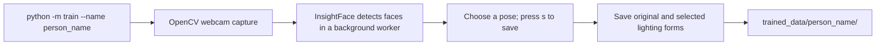
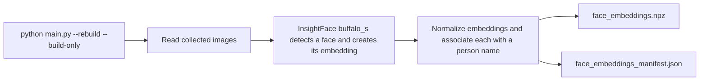
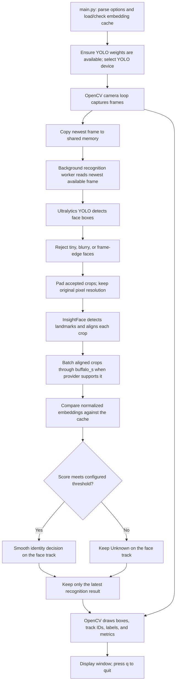

# Face Recognition Pipeline

This document describes the current implementation. It does not change the application code.

## 1. Collect face images



The collector uses a background process for face detection while the camera loop displays frames. It rejects blurry, smaller-than-96-pixel, and frame-edge faces; low-resolution crops are not enlarged. It saves the original plus corrected, dark, bright, and shadow lighting forms. It does not generate grayscale, edge, outline, or pattern forms because the embedding database excludes them.

## 2. Build the embedding database



The recognition database uses images from `originals`, `corrected`, `dark`, `bright`, and `shadow` folders. Other generated forms are saved by the collector but are not included in this embedding database. Images below the enrollment quality threshold are skipped. The manifest records the model and package version, preprocessing settings and source fingerprint, embedding dimension, and enrollment file fingerprint. Live recognition refuses a stale cache; run the build-only command explicitly to rebuild it.

## 3. Run live recognition



The identity score is based on the dot product of normalized embeddings (cosine similarity). The live matcher supports the per-person top-three average or maximum score. The default threshold is `0.45`; `--threshold` can set a value selected from calibration data. Track IDs expire after a period without detections; stable tracks reuse recent embeddings, while new, moving, uncertain, or quality-recovered faces trigger another embedding pass.

The frame buffer and result queue keep only the latest available data. If recognition is slower than camera capture, intermediate frames are skipped instead of accumulating a queue of old frames. Each result carries a frame ID and capture timestamp; results older than the configured age limit are discarded. Display FPS and recognition FPS measure different loops. The overlay reports per-stage YOLO, crop, InsightFace, matching, and result-queue latency, skipped frames, and worker errors.

## Technology stack

| Technology | Role in this project |
| --- | --- |
| Python | Application, training-data collector, and worker processes |
| OpenCV | Webcam capture, image processing, augmentation, drawing, and display |
| Ultralytics YOLOv8 face model | Detects faces in each live frame |
| PyTorch | Runs YOLO; device can be selected with `--device` or chosen automatically (CUDA, Apple MPS, then CPU) |
| InsightFace `buffalo_s` | Detects faces in crops and creates identity embeddings |
| ONNX Runtime | Runs InsightFace models using available CoreML, CUDA, or CPU execution providers |
| NumPy | Stores and compares image and embedding arrays |
| Python multiprocessing and shared memory | Separates camera display from recognition inference while passing the latest frame |
| Local files | Training images, `.npz` embedding cache, JSON manifest, and YOLO model weights |
| YapaLab GitHub Release | Source for downloading the default YOLO weights when they are missing |

The camera processing and identity matching run locally. GitHub is contacted only if the configured YOLO weights need to be downloaded.

## Main files

| File or package | Responsibility |
| --- | --- |
| `main.py` | Command-line entry point, cache loading, model setup, and camera startup |
| `recognition/camera/` | Camera and worker startup, shared-memory lifecycle, display loop, and cleanup |
| `recognition/workers/` | Background recognition worker and latest-frame/result buffers |
| `recognition/detector.py` | YOLO face detection followed by per-face embedding and matching |
| `recognition/recognizer.py` | Compatibility exports for recognition helpers |
| `recognition/face_quality.py` | Face-box quality checks and padded crop preparation |
| `recognition/embeddings.py` | InsightFace face alignment and batched embedding extraction |
| `recognition/matching.py` | Embedding normalization and identity matching |
| `recognition/tracking/` | IoU tracking, embedding reuse, temporal smoothing, and box geometry |
| `recognition/evaluation/` | Offline evaluation CLI, image loading, galleries, metrics, and benchmarks |
| `recognition/embedding_cache.py` | Load the cache builder and validated embedding database |
| `recognition/model_utils.py` | InsightFace setup, YOLO weights, and YOLO device selection |
| `recognition/rendering/` | Face labels and performance overlay |
| `recognition/drawing.py` | Compatibility exports for recognition drawing |
| `runtime_utils.py` | ONNX Runtime execution-provider selection for InsightFace |
| `face_recognition.py` | Build and validate the local embedding database |
| `train/collector/` | Enrollment camera lifecycle, collection loop, and quality-checked saving |
| `train/display/` | Collector controls, overlay, and face drawing |
| `train/dataset.py` | Enrollment folder setup and image saving |
| `train/validation/` and `train/validate_dataset.py` | Duplicate detection and its command-line report |

## Run commands

Collect images and build the cache:

```bash
python -m train --name person_name
python main.py --rebuild --build-only
python -m train.validate_dataset
```

Run recognition on Apple Silicon with the faster, smaller YOLO input:

```bash
python main.py --imgsz 512 --device mps
```

The configured default YOLO image size is `640`; a smaller size can run faster but may miss small or distant faces. Omit `--device mps` on other hardware to use automatic device selection. Use `python -m recognition.evaluation evaluate-matching --enrollment-dir trained_data --calibration-dir calibration_data --test-dir test_data` to compare matching strategies and calibrate a threshold without using the holdout test set for tuning.
